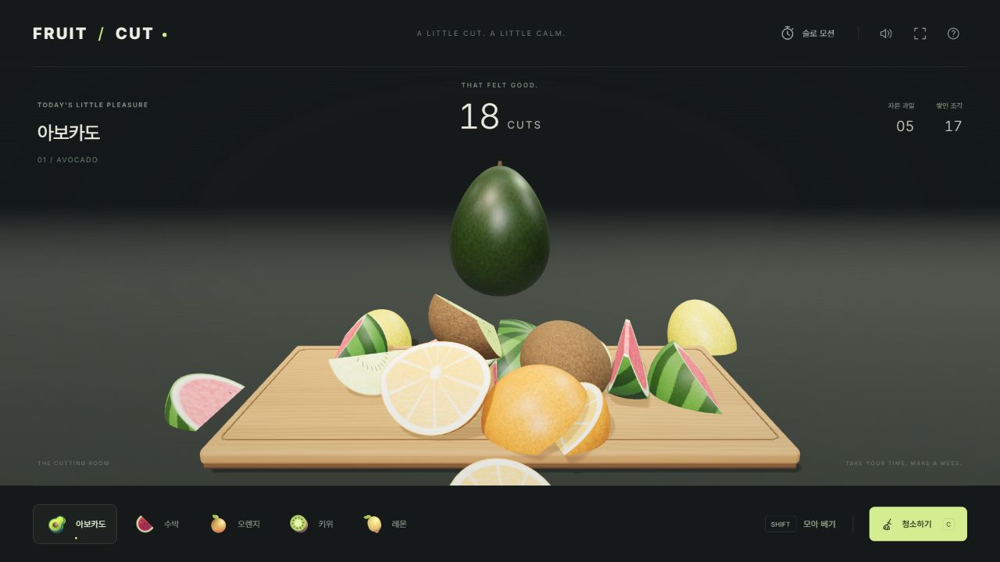

# FRUIT / CUT

참고 이미지의 입체 과일 자르기를 브라우저에서 실행하는 로컬 3D 게임으로 구현했습니다.

**[웹에서 바로 플레이](https://aru-tris.github.io/fruit-cut/)** · **[설치 없는 실행본 다운로드](https://github.com/ARU-Tris/fruit-cut/releases/download/v1.0.0/Fruit-Cut-1.0.0.zip)**



## 실행

웹 플레이 링크를 열거나, 다운로드한 ZIP을 풀고 **`Fruit Cut.html`을 Chrome 또는 Edge에서 열거나 `실행.cmd`를 더블클릭하세요.**

설치, 서버, 계정, 인터넷 연결 없이 실행됩니다. 게임 엔진 프로그램을 따로 켤 필요가 없습니다. WebGL 2와 WebAssembly를 지원하는 브라우저가 필요합니다.

## 조작

| 조작 | 동작 |
| --- | --- |
| 마우스 왼쪽 버튼을 누르고 드래그 → 놓기 | 시작점과 끝점을 잇는 직선으로 과일 절단 |
| Shift를 누른 채 여러 번 드래그 | 과일 표면에 절단선 누적. 이때는 잘리거나 떨어지지 않음 |
| Shift 놓기 | 누적한 모든 선을 한꺼번에 절단 |
| 모아 베기 버튼 | Shift를 계속 누르지 않고 같은 기능 사용 |
| Esc | 누적 절단선 취소 |
| Ctrl+Z | 마지막 누적 절단선 지우기 |
| C / 청소하기 | 떨어진 조각과 과즙 얼룩 청소 |
| Space / 슬로 모션 | 느린 물리 재생 켜기·끄기 |
| 아래 과일 버튼 | 다음 과일 종류 선택. 기존 조각은 보존 |
| 물음표 | 조작법, 그래픽 품질, 효과 강도 설정 |

아보카도·수박·오렌지·키위·레몬 5종을 제공합니다. 잘린 과일은 아래로 떨어지고 새 과일이 오른쪽에서 들어옵니다. 조각은 청소할 때까지 남아 서로 충돌하며 쌓입니다. 플레이 상태는 현재 탭에서 유지되며 새로고침하면 새 게임이 시작됩니다.

## 구현

- Three.js의 입체 조명·그림자와 절차적으로 만든 껍질·과육 재질.
- 마우스 선을 3D 절단 평면으로 변환하여 과일 메시를 분할. 새로운 절단면도 닫힌 입체 형상으로 생성.
- Shift 누적 시 실제 분할을 지연하고 표면에 절단선을 표시.
- Rapier 3D WASM으로 각 조각의 볼록 충돌체, 질량, 회전, 중력, 마찰, 반발, CCD와 수면 상태 계산. 물리 시간 간격은 1/120초.
- 칼 궤적, 과즙 입자, 도마 얼룩, 짧은 타격 정지와 일괄 절단의 짧은 슬로 모션.
- 외부 음원 없이 Web Audio로 베기·낙하·청소 소리 생성.
- 조각 자동 삭제 없음. 많은 조각을 계속 쌓으면 성능은 기기와 조각 수에 영향을 받습니다. 도움말의 ‘가볍게 실행’으로 그림자를 끌 수 있습니다.
- 참고 이미지 `ref/`는 로컬에 보존하며 공개 저장소와 게임 자산에는 포함하지 않습니다.

## 개발

Node.js 22.12 이상 또는 24 권장.

```powershell
npm ci
npm run dev
npm test
npm run build
npm run verify:standalone
```

개발 서버: `http://127.0.0.1:5178/`. 빌드하면 `dist/`와 단독 실행용 `Fruit Cut.html`이 만들어집니다. `src/`가 원본 코드, `tests/`가 형상·물리 검사입니다.

의존성 버전은 `package-lock.json`에 고정되어 있습니다. Third-party 라이선스는 `THIRD_PARTY_NOTICES.txt`를 확인하세요.

`main`에 푸시하면 GitHub Actions가 테스트·빌드·단일 실행본 검사를 통과한 뒤 GitHub Pages에 배포합니다. [검증 기록](evidence/VERIFICATION.md)에는 실제로 확인한 범위와 자동 검증하지 못한 항목을 구분했습니다.
